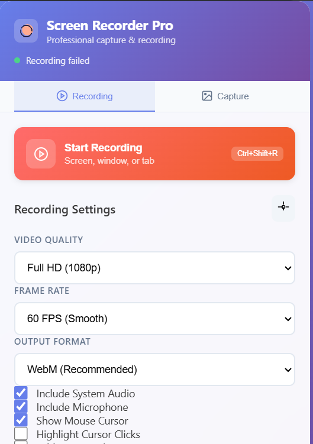

# 🎬 Screen Recorder & Capture Pro - Chrome Extension

**The Ultimate Professional Screen Recording & Capture Solution**

A comprehensive Chrome extension that rivals premium desktop applications like Zoom, Google Meet, and professional screen recording tools. Built with modern web technologies and packed with advanced features for content creators, developers, educators, and professionals.

## 📸 **Extension Screenshot**



## **same extension but built using plasmo framework**

<a href="https://github.com/akashsbadole/screencaptureChromeExtension">using plasmo framework https://github.com/akashsbadole/screencaptureChromeExtension</a>


## ✨ **COMPLETE FEATURE SET** ✨

### 🎥 **Advanced Screen Recording**

- **📺 Multiple Recording Modes**:
  - Full desktop recording
  - Specific window capture
  - Browser tab recording
  - Camera-only recording
  - Picture-in-picture mode
- **🎯 High-Quality Output**: 720p, 1080p, 2K (1440p), 4K (2160p)
- **⚡ Frame Rate Control**: 24, 30, 60, 120 FPS options
- **🎵 Professional Audio**: System audio + microphone mixing with noise reduction
- **🖍️ Live Annotations**: Real-time drawing, highlighting, and markup while recording
- **🖱️ Cursor Effects**: Click highlighting, cursor trails, and visual feedback
- **💧 Watermarks**: Custom text/logo watermarks with positioning control
- **⏱️ Recording Timer**: Auto-stop after specified duration
- **🎙️ Voiceover Support**: Professional voice recording with audio enhancement
- **📁 Multiple Formats**: WebM (recommended), MP4 (compatible), GIF (animated)

### 📸 Screen Capture

- **Multiple Capture Modes**: Full screen, visible area, custom region, or full page scrolling
- **Delayed Capture**: 3, 5, or 10-second countdown timer
- **High-Quality Images**: PNG, JPEG, and WebP formats with quality control
- **Instant Screenshots**: Quick capture with keyboard shortcuts
- **Batch Processing**: Capture multiple areas or pages in sequence

### 🖍️ Advanced Image Editor

- **Professional Annotation Tools**: Pen, highlighter, shapes, arrows, and text
- **Image Effects**: Blur sensitive areas, crop, resize, and apply filters
- **Layer Support**: Multiple annotation layers with undo/redo
- **Custom Styling**: Adjustable colors, sizes, fonts, and opacity
- **Clipboard Integration**: Paste images directly from clipboard
- **Drag & Drop**: Import images from your computer for editing

### 💾 Smart Storage & Sharing

- **Multiple Export Formats**: PNG, JPEG, WebP for images; MP4, WebM, GIF for videos
- **Automatic Organization**: Smart categorization and searchable history
- **Cloud Integration**: Save to local storage with backup options
- **Direct Sharing**: Quick share to Slack, Jira, Trello, GitHub, and more
- **Batch Operations**: Download, share, or delete multiple captures at once

### ⚡ Enhanced User Experience

- **Modern Tabbed Interface**: Separate modes for Recording, Capture, and Editor
- **Real-time Preview**: See your annotations and effects as you apply them
- **Keyboard Shortcuts**: Quick access to all major functions
- **Progress Indicators**: Visual feedback for all operations
- **Responsive Design**: Works perfectly on all screen sizes

## 🎯 Quick Start Guide

### Installation

1. Download or clone this repository
2. Open Chrome and navigate to `chrome://extensions/`
3. Enable "Developer mode" in the top right
4. Click "Load unpacked" and select the `chrome-extension` folder
5. The extension icon will appear in your toolbar

### Basic Usage

#### 🎥 Recording

1. Click the extension icon
2. Select the "Recording" tab
3. Choose "Start Recording" or "Record Camera"
4. Select your screen/window/tab to record
5. Configure audio settings (system audio + microphone)
6. Click "Stop Recording" when finished
7. Your video will automatically download

#### 📸 Screenshots

1. Click the extension icon
2. Select the "Capture" tab
3. Choose your capture method:
   - **Capture Screen**: Full screen screenshot
   - **Capture Area**: Select custom region
   - **Full Page**: Scrolling screenshot of entire page
   - **Delayed Capture**: Countdown timer capture
4. Your image will automatically download

#### 🖍️ Image Editing

1. Click the extension icon
2. Select the "Editor" tab
3. Choose to:
   - **Open Editor**: Start with blank canvas
   - **Paste Image**: Edit clipboard image
   - **Upload Files**: Edit local images
4. Use annotation tools to enhance your image
5. Save your edited image

## ⌨️ Keyboard Shortcuts

| Shortcut                                              | Action               |
| ----------------------------------------------------- | -------------------- |
| `Ctrl+Shift+R` (Windows/Linux)<br>`Cmd+Shift+R` (Mac) | Start/Stop Recording |
| `Ctrl+Shift+C` (Windows/Linux)<br>`Cmd+Shift+C` (Mac) | Quick Screenshot     |
| `Ctrl+Shift+A` (Windows/Linux)<br>`Cmd+Shift+A` (Mac) | Area Selection       |

## 🔧 Technical Specifications

### Recording Capabilities

- **Video Quality**: 720p, 1080p, 2K (1440p), 4K (2160p)
- **Frame Rates**: 24, 30, 60, 120 FPS
- **Audio**: System audio + microphone mixing
- **Formats**: WebM (recommended), MP4, GIF
- **Bitrates**: Adaptive based on quality (2.5-15 Mbps)

### Image Capture

- **Formats**: PNG (lossless), JPEG (compressed), WebP (modern)
- **Quality**: 50-100% adjustable compression
- **Max Resolution**: Up to 4K displays
- **Color Depth**: 24-bit RGB

### Browser Compatibility

- **Chrome**: Version 88+ (Manifest V3)
- **Edge**: Version 88+ (Chromium-based)
- **Permissions**: Desktop capture, storage, downloads, tabs, scripting

## 📁 File Structure

```
chrome-extension/
├── manifest.json              # Extension configuration
├── popup-new.html            # Main popup interface
├── popup-new.css             # Popup styling
├── popup-new.js              # Popup functionality
├── background-new.js         # Background service worker
├── content.js                # Content script for page interaction
├── area-selector.js          # Area selection tool
├── image-editor.js           # Built-in image editor
├── full-page-capture.js      # Full page screenshot
├── history.html              # Capture history viewer
├── history.js                # History management
├── editor.css                # Image editor styling
├── icons/                    # Extension icons
└── README.md                 # This file
```

## 🛠️ Development

### Building from Source

```bash
# Clone the repository
git clone [repository-url]
cd chrome-extension

# The extension is ready to load in Chrome
# No build process required - pure JavaScript
```

### Contributing

1. Fork the repository
2. Create a feature branch: `git checkout -b feature-name`
3. Make your changes and test thoroughly
4. Commit your changes: `git commit -m 'Add feature'`
5. Push to the branch: `git push origin feature-name`
6. Submit a pull request

## 🔒 Privacy & Security

### Data Collection

- ❌ **No personal data collected**
- ❌ **No analytics or tracking**
- ❌ **No cloud uploads without consent**
- ✅ **All processing done locally**
- ✅ **Open source and auditable**

### Permissions Explained

- **activeTab**: Access current tab for screenshots
- **desktopCapture**: Record screen content
- **storage**: Save settings and capture history
- **downloads**: Automatically save captured files
- **tabs**: Manage tab capture functionality
- **scripting**: Inject capture tools into pages
- **clipboardRead/Write**: Paste and copy images

## 🐛 Troubleshooting

### Common Issues

**Recording not starting:**

- Ensure you grant screen capture permissions
- Check if other screen recording software is running
- Try refreshing the page and starting again

**Screenshot appears blank:**

- Make sure the tab is fully loaded
- Check browser permissions for the extension
- Try disabling other screenshot extensions

**Performance issues:**

- Close unnecessary tabs while recording
- Lower recording quality if experiencing lag
- Ensure sufficient disk space for recordings

**Editor not opening:**

- Check if popup blockers are disabled
- Ensure JavaScript is enabled
- Try reloading the extension

## 📞 Support

- **Issues**: Report bugs on GitHub Issues
- **Feature Requests**: Submit via GitHub Discussions
- **Documentation**: Check the wiki for detailed guides
- **Community**: Join our Discord for real-time help

## 📄 License

This project is licensed under the MIT License - see the [LICENSE](LICENSE) file for details.

## 🙏 Acknowledgments

- Built with modern web technologies
- Inspired by professional screen recording tools
- Community feedback and contributions
- Chrome Extension APIs and documentation

## Installation

### From Chrome Web Store (Coming Soon)

1. Visit the Chrome Web Store
2. Search for "Screen Recorder & Capture"
3. Click "Add to Chrome"

### Manual Installation (Developer Mode)

1. Download or clone this repository
2. Open Chrome and go to `chrome://extensions/`
3. Enable "Developer mode" in the top right
4. Click "Load unpacked" and select the `chrome-extension` folder
5. The extension will appear in your toolbar

## Usage

### Screen Recording

1. Click the extension icon in your toolbar
2. Click "Start Recording"
3. Select the screen/window you want to record
4. Choose audio options (microphone/system audio)
5. Click "Stop Recording" when finished
6. The recording will automatically download

### Screen Capture

1. Click the extension icon
2. Choose capture method:
   - **Capture Visible Tab** - Instant screenshot of current tab
   - **Select Area** - Click and drag to select specific area
3. Choose format and quality settings
4. The screenshot will automatically download

### Keyboard Shortcuts

- `Ctrl+Shift+R` - Start/Stop recording
- `Ctrl+Shift+C` - Quick screenshot
- `Ctrl+Shift+S` - Stop current recording

## Permissions

The extension requires the following permissions:

- **activeTab** - To capture screenshots of the current tab
- **desktopCapture** - To record screen content
- **storage** - To save settings and recent captures
- **downloads** - To automatically download captured files
- **tabs** - To manage tab capture functionality

## Privacy & Security

- **No data collection** - We don't collect any personal data
- **Local processing** - All recording and capture happens on your device
- **No cloud uploads** - Files are saved directly to your computer
- **Open source** - Code is available for review

## File Formats

### Recordings

- **WebM** format with VP9/VP8 codec
- **Audio** in Opus format (if enabled)
- **Quality** up to 1080p at 30fps

### Screenshots

- **PNG** - Best quality, larger file size
- **JPEG** - Good quality, smaller file size
- **WebP** - Modern format, excellent compression

## Browser Compatibility

- **Chrome** 88+ (recommended)
- **Edge** 88+ (Chromium-based)
- **Opera** 74+
- **Brave** 1.20+

## Troubleshooting

### Recording Issues

- Ensure you grant screen capture permissions
- Check if other screen recording software is running
- Try refreshing the page and starting again

### Screenshot Issues

- Make sure the tab is fully loaded
- Check browser permissions for the extension
- Try disabling other screenshot extensions

### Performance Issues

- Close unnecessary tabs while recording
- Lower recording quality if experiencing lag
- Ensure sufficient disk space for recordings

## Development

### Building from Source

```bash
# Clone the repository
git clone [repository-url]

# Navigate to extension directory
cd chrome-extension

# The extension is ready to load in Chrome
```

### File Structure

```
chrome-extension/
├── manifest.json          # Extension configuration
├── popup.html             # Extension popup interface
├── popup.css              # Popup styling
├── popup.js               # Popup functionality
├── background.js          # Background service worker
├── content.js             # Content script for page interaction
├── content.css            # Content script styles
├── icons/                 # Extension icons
└── README.md              # This file
```

## Contributing

1. Fork the repository
2. Create a feature branch
3. Make your changes
4. Test thoroughly
5. Submit a pull request

## License

This project is licensed under the MIT License - see the LICENSE file for details.

## Support

For support, feature requests, or bug reports:

- Create an issue on GitHub
- Email: support@screenrecorder.com

## Changelog

### Version 1.0.0

- Initial release
- Basic screen recording functionality
- Screenshot capture with area selection
- Recent captures history
- Keyboard shortcuts support
